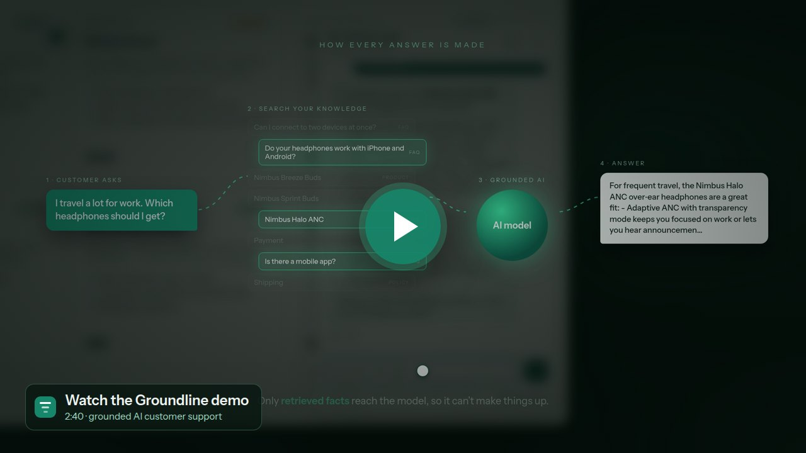

<div align="center">


# Groundline

**AI customer support that only says what your business actually knows.**

Answers from your own products and policies. Hands off to a person when it's unsure.<br>
Shows your team exactly what to add next.

[**▶ Watch the demo**](https://github.com/Yogesh07050/groundline/releases/download/v1.0/Groundline-Demo.mp4) · [Quick start](#quick-start) · [Technical guide](docs/technical-guide.md)

<br>


</div>

<br>

[](https://github.com/Yogesh07050/groundline/releases/download/v1.0/Groundline-Demo.mp4)

<p align="center"><sub>2:40, recorded against the live app and the real model. Nothing scripted, nothing mocked.</sub></p>

## Why Groundline

Most AI chatbots guess. Groundline doesn't.

| | |
|:--|:--|
| 🎯 **Grounded answers** | Every reply is built only from facts in your knowledge base. No invented prices, policies, or promises. |
| 🙋 **Honest handoffs** | When it doesn't know, it says so and passes the customer to your team instead of improvising. |
| 🔍 **Gaps, surfaced** | Every question it couldn't answer is logged, so you always know what to add next. |
| 🛡️ **Guardrails built in** | Stays on topic, resists prompt injection, and keeps your API key on the server. |
| ⚡ **Live in minutes** | One line of HTML on any website. Your brand colour, tone, and contacts are set from the console. |

## What you get

| Chat widget | Operator console | Demo storefront |
|:--|:--|:--|
| Drops onto any site with a single script tag. Streams answers live, works on every device, no build step. | Manage knowledge, read every conversation, work handoffs, and see answer rates and gaps at a glance. | A sample shop for *Nimbus Audio*, built from the same knowledge base, so you can see the whole loop end to end. |

## How it works

1. **A customer asks** a question in the widget.
2. **Groundline searches** your products, policies, and FAQs for the relevant facts.
3. **The AI answers** using only those facts, streamed to the customer as it's written.
4. **Every conversation is labelled** answered, referred, or gap, so the dashboard shows what's working.

Only retrieved facts reach the model, so it can't make things up.

## Quick start

```bash
npm install
cp .env.example .env        # add GROQ_API_KEY and ADMIN_PASSWORD
npm run build && npm start
```

Open <http://localhost:3000>. The console is at `/app`. Prefer Docker? `docker compose up --build`.

Needs Node.js 20.19 or newer. Setup details, API reference, import formats, security notes, and
testing are in the [technical guide](docs/technical-guide.md).

## Make it yours

1. Replace the sample content on the **Knowledge** page, or import a CSV or JSON file.
2. Set your persona, brand facts, support contacts, and accent colour in **Settings**.
3. Paste the embed line from Settings into your website. Done.

## Good to know

- Handoffs land in the console for your team to answer. Email notifications aren't included yet.
- Answers come from the knowledge base only. There's no order or checkout lookup.
- Built for one business on one server. Scaling out needs a shared database and rate-limit store.

<br>

<div align="center">
<sub>MIT licensed · Nimbus Audio, its products, prices, and policies are fictional sample data.</sub>
</div>
